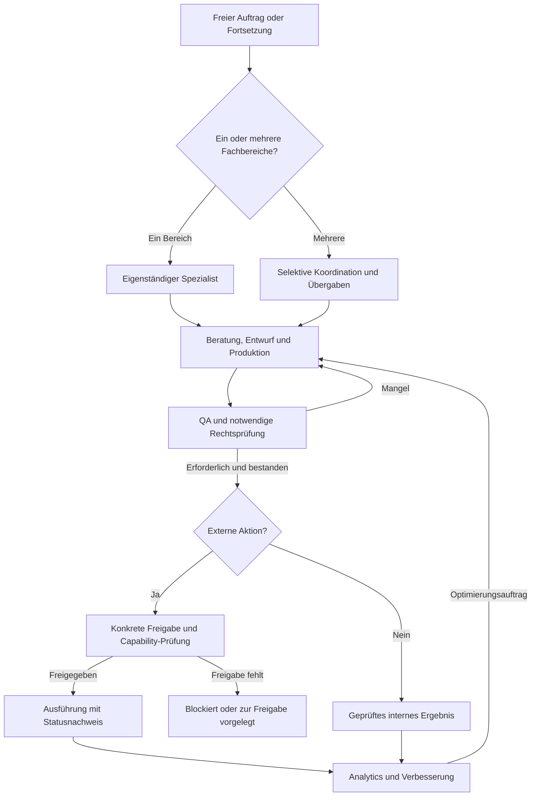

# Agentic Marketing Suite

**Eine offene, KI-native Arbeitsumgebung für Beratung, Strategie, Kreation, Kommunikation, Umsetzung und Wirkungskontrolle in Werbung und Marketing.**

[GitHub-Repository](https://github.com/markus-ertel/agentic-marketing-suite) · [MIT-Lizenz](LICENSE.md) · [Beiträge](CONTRIBUTING.md) · [Sicherheitsmeldungen](SECURITY.md) · [Installation und Migration](MIGRATION.md)

| Dokument | Stand |
|---|---|
| Dokumentation | README v0.3 · 26. Oktober 2026 |
| Beschriebene Softwarebasis | Integrierte Suite v0.2 mit gemeinsamer Governance-Ebene v0.2 (Änderungen: [`.suite/HISTORY.md`](.suite/HISTORY.md)) |
| Fachbereiche | 8 eigenständig nutzbare Module |
| Fachmethoden im untersuchten Paket | 469 Markdown-Methodendateien |
| Zielgruppe | Unternehmen, Selbstständige, Fachleute und Agenturen; **keine** Agentur- oder Kundenverwaltung als Voraussetzung |
| Charakter | Architektur, Methodenbibliothek, Arbeitskonventionen, lokale Hilfswerkzeuge; **keine** fertig angebundene All-in-one-SaaS-Anwendung |

> **Leitgedanke:** Der Mensch beschreibt ein Anliegen und beurteilt die wirklich wichtigen Entscheidungen. Die KI übernimmt möglichst viel fachliche Analyse, Beratung, Ausarbeitung, Koordination und – bei vorhandenen Werkzeugen und Berechtigungen – operative Durchführung. Der Mensch soll keine internen Markdown-Dateien verwalten müssen.

> **Wichtiger Reifegrad-Hinweis:** Die Suite stellt bereits verwendbare Arbeitsanweisungen, Methoden, Beispiele, teilweise ausführbare lokale Prüfwerkzeuge und offene JSON-Verträge bereit. Sie enthält **keine automatisch eingerichteten Werbekonten, Postfächer, Messenger, KI-Modelle oder Publishing-Verbindungen**. Sicherheit, Freigaben und Compliance müssen vom ausführenden Harness auch **technisch** durchgesetzt werden. Das Lesen einer `AGENT.md` ist weder eine Ausführungsgenehmigung noch der Nachweis einer erfolgreichen Handlung.

---

## Inhaltsverzeichnis

1. [Überblick und Grundidee](#1-überblick-und-grundidee)
2. [Ziele und Nicht-Ziele](#2-ziele-und-nicht-ziele)
3. [Für wen ist die Suite gedacht?](#3-für-wen-ist-die-suite-gedacht)
4. [Schnellstart](#4-schnellstart)
5. [Architektur und Verzeichnisstruktur](#5-architektur-und-verzeichnisstruktur)
6. [Die acht Fachspezialisten](#6-die-acht-fachspezialisten)
7. [Arbeitsprinzipien der KI](#7-arbeitsprinzipien-der-ki)
8. [Fachmethoden und Methodenwahl](#8-fachmethoden-und-methodenwahl)
9. [Der bereichsübergreifende Gesamtablauf](#9-der-bereichsübergreifende-gesamtablauf)
10. [Zusammenarbeit und Wissensaustausch](#10-zusammenarbeit-und-wissensaustausch)
11. [Qualitätssicherung](#11-qualitätssicherung)
12. [Recht und Compliance](#12-recht-und-compliance)
13. [Berechtigungen, Freigaben und Außenwirkung](#13-berechtigungen-freigaben-und-außenwirkung)
14. [Daten, Artefakte und offene Verträge](#14-daten-artefakte-und-offene-verträge)
15. [Zustand, Log, Historie und Archivierung](#15-zustand-log-historie-und-archivierung)
16. [Sicherheit und Datenschutz in der Laufzeit](#16-sicherheit-und-datenschutz-in-der-laufzeit)
17. [Tooling und optionale Integrationen](#17-tooling-und-optionale-integrationen)
18. [Praktische Anwendungsfälle](#18-praktische-anwendungsfälle)
19. [Beispiel TOPACA: Markenbekanntheit aufbauen](#19-beispiel-topaca-markenbekanntheit-aufbauen)
20. [Installation, Aktualisierung und Backup](#20-installation-aktualisierung-und-backup)
21. [Tests und Qualitätsnachweise](#21-tests-und-qualitätsnachweise)
22. [Fehlerbehebung](#22-fehlerbehebung)
23. [Eigene Methoden und Module ergänzen](#23-eigene-methoden-und-module-ergänzen)
24. [Weiterentwicklung und offene Aufgaben](#24-weiterentwicklung-und-offene-aufgaben)
25. [Begriffe, Dokumente und Referenzen](#25-begriffe-dokumente-und-referenzen)

---

## 1. Überblick und Grundidee

Die **Agentic Marketing Suite** organisiert Werbung, Marketing und Marktkommunikation nicht als eine große Software mit Hunderten Menüs, sondern als **Zusammenarbeit unabhängiger KI-Fachspezialisten**. Jeder Spezialist kann Menschen fachkundig beraten, passende Methoden auswählen, Materialien erarbeiten, vorhandene Ergebnisse prüfen und – sofern die Laufzeit dies unterstützt – Aufgaben mit geeigneten Werkzeugen ausführen.

Die Suite verbindet drei Ebenen:

1. **Fachkompetenz:** Acht eigenständige Module für Marketing, Öffentlichkeitsarbeit, Social Media, Website/noCMS, Advertising, Creative, noCRM und Analytics.
2. **Gemeinsame Prinzipien:** Qualität, rechtliche Mindeststandards, Sicherheitsgrenzen, Ergebnisübergaben, Freigaben, Zustandsverwaltung und Nachvollziehbarkeit.
3. **Ausführungsumgebung:** Ein KI-Harness, KI-Modell oder Cognitive Computer, der Dateien lesen, Methoden anwenden und optional über explizit erlaubte Capabilities mit externen Systemen arbeiten kann.

Die Fachkompetenz ist überwiegend als **lesbare Markdown-Dateien** beschrieben. Sie wird bei Bedarf mit offenen Datenformaten, Programmen, Schemas und Medienartefakten ergänzt. Damit bleiben Inhalte unabhängig von einem bestimmten LLM-Anbieter oder einer proprietären Marketingplattform bearbeitbar.

**Beispiel:** Eine Person möchte die Bekanntheit ihres Unternehmens steigern. Die KI beurteilt zuerst Ziel, Ausgangslage, Zielgruppen und Ressourcen, schlägt eine begründete Strategie vor und erstellt einen brauchbaren ersten Entwurf. Sie fragt nur nach Informationen, ohne die eine verantwortbare Entscheidung nicht möglich ist. Je nach Auftrag arbeiten anschließend PR, Social Media, Creative, Website, Advertising und Analytics mit. Keines dieser Module muss als zentrale Pflichtstation durchlaufen werden.

### 1.1 Die entscheidende Unterscheidung

Die Suite ist **kein Fragebogen mit KI**, **kein rein textproduzierender Chatbot** und **keine automatische Massenmarketing-Maschine**. Ein guter Spezialist erkennt, wann eine Maßnahme ungeeignet, unzulässig oder wirtschaftlich wenig sinnvoll ist und schlägt eine bessere Alternative vor.

Die Maßgabe lautet:

**Auftrag verstehen → Fachlich beurteilen → Nutzbares Ergebnis liefern → Prüfen → gegebenenfalls sicher ausführen → Wirkung beurteilen → verbessern.**

Die Reihenfolge ist dynamisch. Ein kleiner Textauftrag benötigt keinen vollständigen Kampagnenprozess.

---

## 2. Ziele und Nicht-Ziele

### 2.1 Ziele

- **Beratung statt bloßer Bedienung:** Fachlich eigenständige Empfehlungen, begründete Prioritäten, Kritik und Alternativen.
- **Schneller Nutzwert:** Erstentwürfe und konkrete Resultate vor langen Interviews.
- **Einfachheit:** Kleine, bedarfsorientierte Arbeitsumgebung statt einer überladenen Komplettsoftware.
- **Modularität:** Jeder Bereich funktioniert auch ohne die übrigen sieben Bereiche.
- **Zusammenarbeit:** Gemeinsame Strategien, Markeninformationen und Erkenntnisse nutzen, ohne unnötige Datenkopien.
- **Portabilität:** Markdown, HTML/CSS/JS, CSV, JSON, JSONL, SVG und andere dokumentierte Standards, wo fachlich sinnvoll.
- **Kontrollierte Außenwirkung:** Veröffentlichungen, Nachrichten, Media-Einkäufe und andere relevante Aktionen nur mit passender Autorisierung.
- **Nachvollziehbarkeit:** Quellen, Versionen, Entscheidungen, Prüfungen und tatsächliche Ausführungsresultate dokumentieren.
- **Verbesserung durch Evidenz:** Ergebnisse messen, Unsicherheit beurteilen und Optimierungen anstoßen.

### 2.2 Nicht-Ziele

- Kein verpflichtendes CRM, ERP, CMS, Datenbank-, Cloud- oder Agenturverwaltungssystem.
- Kein allwissender Zentral-Agent, der Fachentscheidungen der Spezialisten ersetzt.
- Kein Versprechen, dass eine KI rechtliche Konformität vollständig zertifizieren kann.
- Keine automatischen Ausgaben, Veröffentlichungen oder Nachrichten allein aufgrund eines allgemeinen Marketingauftrags.
- Kein Zwang, sämtliche Methoden, Dateien oder Module gleichzeitig zu laden.
- Keine verpflichtende feste Abfolge von Marketinganalyse bis Analytics für jeden Auftrag.
- Keine Annahme, dass Plattform-APIs ohne Berechtigungen, App-Freigaben oder Konfiguration tatsächlich benutzt werden können.

---

## 3. Für wen ist die Suite gedacht?

Die erste Architektur betrachtet **eine Organisation oder ein Unternehmen als Arbeitsumgebung**. Das kann eine Einzelperson, ein Startup, ein etabliertes Unternehmen, ein Verein oder auch eine Werbeagentur sein.

Sie setzt **keine Kundenordner** voraus. Wer später mehrere Mandanten betreuen möchte, kann jede Organisation in einer getrennten Instanz oder einem getrennten Verzeichnis mit eigenen Berechtigungen und Daten führen. Eine mandantenfähige Agenturverwaltung ist **nicht** Teil des derzeitigen Kerns.

### 3.1 Zwei typische Betriebsweisen

**Eigenes Unternehmen:** Die Organisation nutzt die Suite für die eigene Marke und eigene Aktivitäten. Alle acht Bereiche können auf berechtigt zugängliche Unternehmensinformationen zurückgreifen.

**Beratungs- oder Agenturbetrieb:** Die Organisation betreut mehrere Marken. Hier sind zusätzliche Trennung von Kundendaten, Konten, Zustimmungen, Rollen und Berechtigungen nötig. Die Fachmodule selbst benötigen dafür keine neue Methodenarchitektur.

### 3.2 Was Anwender nicht wissen müssen

Menschen sollen weder `SWOT`, `TAM/SAM/SOM` noch eine interne JSON-Schema-Bezeichnung kennen müssen. Sie beschreiben ihr Ziel, zum Beispiel:

> „Unsere Website wirkt veraltet. Analysiere sie, empfehle Verbesserungen und erstelle einen neuen Entwurf.“

Der Website-Spezialist wählt geeignete Verfahren selbst. Mit derselben Grundidee werden alle anderen Bereiche genutzt.

---

## 4. Schnellstart

### 4.1 Voraussetzungen

**Für reine Beratung und Dokumentenentwürfe:**

- Zugriff auf die entpackten Ordner und die Möglichkeit, `.md`-Dateien zu lesen;
- ein geeignetes KI-Modell mit ausreichend Kontext;
- ein Chat-, Editor-, Terminal- oder Harness-Zugang, der dem Modell die relevanten Dateien bereitstellt.

**Für das tatsächliche Schreiben von Ergebnissen:** Zusätzlich braucht die Laufzeit Berechtigungen zur Datei- und Verzeichnisverwaltung.

**Für externe Aktionen:** Zusätzlich benötigt sie geeignete, konfigurierte Schnittstellen, Credentials in einem sicheren Secret Store, nachweisbare Freigaben und Statuskontrollen.

**Für enthaltene lokale Tests:** Python 3 mit Standardbibliothek. Manche modulbezogenen Werkzeuge können eigene Voraussetzungen besitzen; deren Dokumentation beachten.

> Ein LLM, dem man nur den Text der `AGENT.md` in einem Chat zeigt, besitzt dadurch noch **keinen** Zugriff auf das Dateisystem oder externe Dienste. Es kann beraten und Entwürfe liefern, aber keine Dateien, Anzeigen, Posts oder E-Mails tatsächlich ändern, wenn dafür keine Tools verfügbar sind.

### 4.2 In Betrieb nehmen

1. Das [GitHub-Repository](https://github.com/markus-ertel/agentic-marketing-suite) klonen oder das Suite-Archiv entpacken und die Ordnerstruktur erhalten, **einschließlich versteckter Ordner** wie `.suite/`, `.nocms/` und `.analytics/`.
2. Den entpackten Ordner `agentic-marketing-suite/` als erlaubtes Arbeitsverzeichnis für den Harness bereitstellen.
3. Für eine allgemeine oder bereichsübergreifende Arbeit die Root-Datei `AGENT.md` lesen lassen.
4. Für einen einzelnen Fachauftrag direkt die jeweilige Modul-`AGENT.md` verwenden.
5. Ein Ziel in natürlicher Sprache formulieren; die KI soll darauf **direkt fachlich reagieren**.
6. Erst bei konkreter Dateiarbeit oder externer Aktion die dafür notwendigen Rechte und Werkzeuge bereitstellen.

**Einstiegsaufforderung für die gesamte Suite:**

```text
Lies AGENT.md im Hauptverzeichnis der Agentic Marketing Suite
und beachte die dort referenzierten verbindlichen Regeln.
```

Wenn noch kein Auftrag genannt wurde, lautet die vorgesehene Antwort:

> Wobei kann ich Ihnen bei Werbung und Marketing helfen?

**Einstieg in einen Fachbereich:**

```text
Lies website/AGENT.md. Berate mich zum Relaunch unserer Website.
```

Hier soll die KI **nicht zuerst die Einstiegsfrage wiederholen**, sondern bereits eine erste fachliche Einschätzung liefern und vorhandenes Wissen sichten.

### 4.3 Ein Mini-Test

```text
Lies marketing/AGENT.md. Unser Unternehmen ist noch unbekannt.
Wir haben 5.000 Euro Jahresbudget und fünf Stunden pro Woche.
Entwickle ein erstes Konzept für zwölf Monate.
```

**Erwartung:** Eine begründete Strategie, Prioritäten, realistische Maßnahmen und erkennbare Annahmen. **Nicht** zwölf Onboarding-Fragen oder die Bitte, selbst eine Methode auszuwählen.

### 4.4 Sprachgebrauch in der Suite

Die konkreten Dateien verwenden den Begriff **Agent** als praktischen Einstieg für einen KI-Harness. Fachlich handelt es sich um **Spezialisten mit Methoden und Capabilities**. Ein Agenten-Schwarm oder eine besondere proprietäre Agentenplattform ist keine Voraussetzung.

### 4.5 Lokales Browser-Dashboard

Unter [`.suite/dashboard/`](.suite/dashboard/README.md) steht eine lokale Browseroberfläche für die gesamte Suite bereit: Dateinavigation und Suche, Vorschauen für Markdown, Text, JSON, CSV, Bilder, HTML, PDF und Medien, automatische Anzeige externer Änderungen sowie Chat mit **Codex und Pi**. Die Fachmodule bleiben eigenständig nutzbar.

Installation und Start im Suite-Root mit Python 3.9 oder neuer:

```sh
python3 -m venv .venv
.venv/bin/python -m pip install -r .suite/dashboard/requirements.txt
.venv/bin/python .suite/dashboard/server/app.py
```

Im Browser die ausgegebene Adresse öffnen, standardmäßig `http://127.0.0.1:8765`. Stoppen mit **Strg+C**. Host und Port sind in `.suite/dashboard/config.json` konfigurierbar; Port `0` wählt einen freien Port.

Die Dateiansicht funktioniert ohne Agentenprogramm. Für den Chat müssen Codex beziehungsweise Pi im Startterminal verfügbar und eingerichtet sein. Bei einem lokalen Pi-Modell muss auch der Modellserver laufen. Agent und Arbeitsverzeichnis werden separat gewählt; eine geöffnete Datei wird nur auf ausdrücklichen Wunsch als Pfad referenziert. Das Dashboard verändert selbst keine Fachdateien.

**Geprüft:** echte Pi- und Codex-Antworten mit laufender Ausgabe und bestätigtem Abschluss; mit Codex zusätzlich mehrere Sitzungen, externe Dateierstellung und Sitzungswiederaufnahme. Details stehen in der [Dashboard-Anleitung](.suite/dashboard/README.md) und im [Abnahmeprotokoll](.suite/dashboard/ABNAHME.md).

---

## 5. Architektur und Verzeichnisstruktur

### 5.1 Übersicht

```text
agentic-marketing-suite/
├── README.md                  # Dieses Handbuch
├── AGENT.md                   # Optionaler übergreifender Einstieg
├── MIGRATION.md               # Additive Integration/Upgrade
│
├── .suite/                    # Gemeinsame Regeln und Verträge
│   ├── ARCHITECTURE.md
│   ├── WORKFLOW.md
│   ├── QUALITY.md
│   ├── LEGAL.md
│   ├── GOVERNANCE.md
│   ├── SECURITY.md
│   ├── INTERFACES.md
│   ├── MODULES.md
│   ├── STRUKTUR.md
│   ├── TESTFAELLE.md
│   ├── STATE.md
│   ├── LOG.md
│   ├── HISTORY.md
│   ├── qa/                     # Gemeinsame QA-Methoden
│   ├── legal/                  # Rechtliche Prüfleitfäden und Quellen
│   ├── contracts/              # Offene JSON-Schemas
│   ├── tools/                  # Lokale Prüfwerkzeuge
│   ├── tests/                  # Automatisierte Basistests
│   └── beispiele/
│
├── marketing/                 # Strategie und Marketingkonzeption
│   ├── AGENT.md
│   └── .marketing/
├── pr/                        # Öffentlichkeitsarbeit
│   ├── AGENT.md
│   └── .pr/
├── social-media/              # Kanäle, Redaktion, Community
│   ├── AGENT.md
│   └── .social-media/
├── website/                   # Webberatung und noCMS
│   ├── AGENT.md
│   └── .nocms/
├── advertising/               # Werbung, Media, Kampagnen
│   ├── AGENT.md
│   └── .advertising/
├── creative/                  # Gestaltung und Medienproduktion
│   ├── AGENT.md
│   └── .creative/
├── noCRM/                     # Individuelle Kommunikation
│   ├── AGENT.md
│   └── .nocrm/
├── analytics/                 # Daten, Wirkung, Lernen
│   ├── AGENT.md
│   └── .analytics/
│
└── vorhaben/                  # Optional; erst bei gemeinsamen Aufträgen
    └── <vorgangs-id>/
```

**Hinweis:** Die Grafik zeigt die **logische Sollstruktur**. Leere `input/`- und `archiv/`-Ordner oder dynamische Ergebnisordner sind im ZIP nicht immer physisch enthalten. Sie werden angelegt, wenn eine konkrete Tätigkeit sie benötigt.

### 5.2 Was liegt wo?

| Ebene | Aufgabe | Typische Inhalte |
|---|---|---|
| `AGENT.md` im Root | Fachübergreifender Einstieg | Auftragsannahme, selektive Modulwahl, gemeinsame Regeln |
| `.suite/` | Gemeinsame Mindeststandards | QA, Recht, Governance, Sicherheit, Übergabeverträge |
| `<modul>/AGENT.md` | Fachliche Identität und Startverhalten | Beratungsregeln und Verweise |
| `<modul>/.<intern>/` | Interne Fachanleitungen | Methoden, Formate, Integrationsprofile, Zustand, Log |
| `<modul>/...` außerhalb des internen Ordners | Tatsächliche Arbeitsergebnisse | Strategien, Postings, Layouts, Webdateien, Berichte |
| `input/` im Modul | Temporärer Eingang | Vom Menschen bereitgestellte Briefings, Medien, Unterlagen |
| `archiv/` im Modul | Nachvollziehbare Aufbewahrung | Originale und geeignete frühere Versionen |
| `vorhaben/` im Root | Bereichsübergreifende Aufträge | Vorgangsreferenzen, Verknüpfungen, Review-/Freigabeakte |

Der führende Gedanke lautet: **Anleitungen und Arbeitsergebnisse gehören nicht in denselben Ablagebereich.**

### 5.3 Dynamische Ergebnisordner

Angenommen, `marketing/` erarbeitet eine Positionierung. Dann könnte es einen sichtbaren Ordner `marketing/strategie/` erzeugen:

```text
marketing/
├── AGENT.md
├── .marketing/
│   └── methoden/strategie/positionierung.md   # Methodenbeschreibung
└── strategie/
    └── positionierung.md                      # Konkretes Ergebnis
```

Ebenso werden beispielsweise `social-media/kampagnen/`, `creative/print/` oder `analytics/berichte/` **nicht prophylaktisch** angelegt. Eine neue Aufgabe erzeugt nur die tatsächlich benötigten Artefakte.

### 5.4 Warum `.suite/` optional ist

Die gemeinsame Ebene **koordiniert nur dann**, wenn mehrere Fachbereiche miteinander arbeiten oder gemeinsame Prüf-/Freigaberegeln benötigt werden. Sie soll kein Monolith werden.

Ein direkter Auftrag an `pr/` bleibt ein PR-Auftrag. Ein Auftrag an `creative/` bleibt eine Gestaltungstätigkeit. Ein komplexer Markteintritt kann dagegen mehrere Fachspezialisten verbinden. Das Marketing-Modul ist fachlich wichtig, aber **keine verpflichtende Hierarchie über allen anderen Modulen**.

### 5.5 Eigenständigkeit ist keine schrankenlose Isolation

Ein Spezialist darf auf berechtigt zugängliche Strategie-, Marken- und Ergebnisdateien der Nachbarmodule zurückgreifen. Das bedeutet **nicht**, dass er deren Dateien überschreiben, Kontaktlisten kopieren, Credentials lesen oder deren Entscheidungen still verändern darf. Die gemeinsame Ebene regelt **Übergaben** und **Grenzen**, nicht die fachliche Entmündigung der Module.

---

## 6. Die acht Fachspezialisten

| Modul | Fachlicher Auftrag | Methoden im untersuchten Paket | Interner Methodenindex |
|---|---|---:|---|
| **Marketing** | Ziele, Märkte, Zielgruppen, Positionierung, Marketingstrategie und -konzepte | 45 | [`marketing/.marketing/METHODEN.md`](marketing/.marketing/METHODEN.md) |
| **PR** | Öffentlichkeitsarbeit, Medienbeziehungen, Reputation, Themen- und Krisenkommunikation | 46 | [`pr/.pr/METHODEN.md`](pr/.pr/METHODEN.md) |
| **Social Media** | Kanalstrategie, Content, Formate, Community, Publishing und Monitoring | 69 | [`social-media/.social-media/METHODEN.md`](social-media/.social-media/METHODEN.md) |
| **Website / noCMS** | Website-Beratung, UX, Konzeption, HTML/CSS/JS-Umsetzung, Pflege und QA | 34 | [`website/.nocms/METHODEN.md`](website/.nocms/METHODEN.md) |
| **Advertising** | Werbestrategie, kreative Leitidee, Anzeigen, Kampagnen, Media und Shopping | 72 | [`advertising/.advertising/METHODEN.md`](advertising/.advertising/METHODEN.md) |
| **Creative** | Gestaltung, Art Direction, Corporate Design, Bild, Video, Audio und Print | 71 | [`creative/.creative/METHODEN.md`](creative/.creative/METHODEN.md) |
| **noCRM** | Individuelle 1:1-Kommunikation, Beziehungskontext, Antworten, Service, Nachbetreuung | 59 | [`noCRM/.nocrm/METHODEN.md`](noCRM/.nocrm/METHODEN.md) |
| **Analytics** | Datenqualität, Wirkungsbeurteilung, Experimente, Interpretation und Verbesserung | 73 | [`analytics/.analytics/METHODEN.md`](analytics/.analytics/METHODEN.md) |
| **Gesamt** | | **469** | |

Die Zahlen beschreiben den **Dateibestand**, nicht die Zahl bereits empirisch nachgewiesener, autonom beherrschter Fähigkeiten.

### 6.1 Marketing – Strategie und übergreifende Marketingberatung

**Einstieg:** [`marketing/AGENT.md`](marketing/AGENT.md)

Marketing betrachtet das Unternehmen, seine Ziele, das Angebot, Markt und Wettbewerb sowie realistische Ressourcen. Der Spezialist entwickelt und überprüft Marketingstrategien, Zielgruppenhypothesen, Positionierungen, Nutzenversprechen, Konzepte und Pläne.

**Typische Aufträge:**

- „Entwickle aus unseren Unternehmenszielen ein Marketingkonzept.“
- „Wie sollten wir uns gegenüber etablierten Wettbewerbern positionieren?“
- „Überprüfe unsere Zielgruppenauswahl und schlage eine bessere Priorisierung vor.“
- „Leite aus unserer Strategie ein Werbekonzept ab.“

Wichtig: Marketing **berät**. Es muss auch feststellen können, dass ein vorgeschlagener Kanal oder eine Kampagne nicht zum Ziel oder Budget passt. Andere Module sind keine Pflichtstationen.

### 6.2 PR – Öffentlichkeitsarbeit und Reputation

**Einstieg:** [`pr/AGENT.md`](pr/AGENT.md)

PR beurteilt Nachrichtenwert, öffentliche Interessen, Stakeholderbeziehungen und Medienlogik. Es konzipiert Pressearbeit, Pitches, Statements, Interviews, Thought Leadership, Issues-Management und Krisenkommunikation.

**Typische Aufträge:** „Ist diese Ankündigung eine Pressemitteilung wert?“, „Entwickle eine PR-Strategie“, „Bereite kritische Fragen für ein Interview vor.“

Eine PR-Leistung ist **nicht** automatisch eine E-Mail an möglichst viele Journalisten. Medienkontakte und Aussendungen benötigen geeignete rechtliche Grundlagen, korrekte Fakten und gegebenenfalls Freigaben.

### 6.3 Social Media – Kanal- und Formatkompetenz

**Einstieg:** [`social-media/AGENT.md`](social-media/AGENT.md)

Dieser Spezialist verbindet kanalübergreifende Themenstrategie mit kanal- und formatspezifischer Umsetzung. Er unterscheidet unter anderem Textbeiträge, Bildposts, Carousels, Stories, Reels, Shorts, längere Videos und Live-Formate. Plattformprofile und Formatprofile sind getrennt, sodass ein Konzept sinnvoll adaptiert werden kann.

**Typische Aufträge:** „Welche zwei Kanäle lohnen sich für uns?“, „Erstelle aus diesem Fachartikel drei kanalspezifische Beiträge“, „Entwickle einen Monatsplan“, „Prüfe die Video- und Textformate.“

**Hinweis zur Veröffentlichung:** [`social-media/.social-media/PUBLISHING.md`](social-media/.social-media/PUBLISHING.md) beschreibt Vorbereitung, Prüfungen, Freigaben und technische Veröffentlichung. Ein Profil oder Adaptervertrag beweist **keine** eingerichtete Live-API. Plattformen können zusätzliche Kontoarten, Prüfungen und Formatbeschränkungen verlangen.

### 6.4 Website – Beratung plus noCMS-Umsetzung

**Einstieg:** [`website/AGENT.md`](website/AGENT.md)

**noCMS bezeichnet ausschließlich den Website-KI-Prozess – kein klassisches CMS.** Der Website-Spezialist berät zu Website-Strategie, Nutzerführung, Struktur, Webdesign, Inhalt, SEO, Barrierefreiheit, Sicherheit, technischer Umsetzung und Wartung. Wird die Umsetzung beauftragt, verwendet er die bestehenden noCMS-Prinzipien zur Erstellung und Pflege von HTML/CSS/JS.

**Typische Aufträge:** „Ist eine neue Website notwendig?“, „Plane eine Produkt-Landingpage“, „Verbessere unsere Navigation“, „Erstelle eine Website auf Basis unseres Corporate Designs.“

Für Shop, Forum und andere zustandsbehaftete Anwendungen können **separate Application-/Capability-Interfaces** erforderlich sein; sie sollen nicht dadurch simuliert werden, dass allein statisches HTML/CSS/JS erzeugt wird.

### 6.5 Advertising – bezahlte Werbewirkung und Mediaplanung

**Einstieg:** [`advertising/AGENT.md`](advertising/AGENT.md)

Advertising entwickelt Werbestrategien, kreative Konzepte, Anzeigenvarianten, Kampagnenpläne, Zielgruppen- und Mediamixe, Budgets, Shopping- und Retail-Media-Ansätze. Berücksichtigt werden auch Video-, YouTube-/Shorts-, Such-, Display-, Social-, Streaming- und potenzielle KI-native Werbeumfelder.

**Typische Aufträge:** „Erstelle einen Mediaplan für 3.000 €“, „Entwickle eine kreative Leitidee und drei Anzeigenmotive“, „Bewerte Google Shopping gegenüber Search“, „Prüfe bezahlte Werbung auf einer KI-Plattform.“

**Betriebsregel:** Kanalverfügbarkeit, Kontoberechtigung, API-Fähigkeit, Anzeigenrichtlinie, Budgetgrenze und Kostenfreigabe sind jeweils aktuell zu prüfen. Nennung eines Werbekanals bedeutet **keine** automatische Buchungsfähigkeit. Details: [`advertising/.advertising/MEDIA_BUYING.md`](advertising/.advertising/MEDIA_BUYING.md).

### 6.6 Creative – Gestaltung und Medienproduktion

**Einstieg:** [`creative/AGENT.md`](creative/AGENT.md)

Creative ist der Spezialist für Art Direction, Corporate Design, Grafik, Layout, Bild-, Video- und Audioerstellung, Animation sowie Printwerbemittel. Fachliche Prüfung ist Teil der Produktion: **Erstellen → Evaluieren → Korrigieren → erneut prüfen.**

**Typische Aufträge:** „Entwickle ein Key Visual“, „Erstelle einen Folder nach unserem CD“, „Prüfe diese Grafik auf Briefingtreue“, „Bereite einen druckfertigen Produktionsprozess vor.“

Printproduktion soll nach Möglichkeit aus strukturierten Gestaltungsdaten und deterministisch positionierten Layoutobjekten erfolgen. Ein RGB-Bildproof oder ein beliebiges PDF darf **nicht** als druckfertig bezeichnet werden, wenn etwa Beschnitt, Bildauflösung, Schriften, ICC-/Druckprofil und passende PDF/X-Prüfung nicht tatsächlich abgeschlossen sind. Siehe [`creative/.creative/PRINT.md`](creative/.creative/PRINT.md).

### 6.7 noCRM – individuelle 1:1-Kommunikation

**Einstieg:** [`noCRM/AGENT.md`](noCRM/AGENT.md)

noCRM ist **kein klassisches CRM** und kein Tool zur skalierenden Kaltakquise. Der Schwerpunkt liegt auf fachlich und menschlich angemessener Kommunikation mit einzelnen Personen. Kontext, Kontaktpräferenzen, bisherige Korrespondenz und berechtigte Handlungsabsichten fließen in individuelle Entwürfe und Dialoge ein.

Offene Datenformate können etwa CSV für einen schlanken Kontaktindex und JSONL für Ereignisse umfassen. **Ein Beziehungsgedächtnis ist kein Einwilligungsnachweis.** Werbliche Direktkommunikation benötigt eine passende rechtliche Grundlage und muss kanalbezogen geprüft werden.

Wichtige Dateien: [`DATENMODELL.md`](noCRM/.nocrm/DATENMODELL.md), [`EINWILLIGUNG.md`](noCRM/.nocrm/EINWILLIGUNG.md), [`AKTIONEN.md`](noCRM/.nocrm/AKTIONEN.md).

### 6.8 Analytics – unabhängige Wirkungsbeurteilung

**Einstieg:** [`analytics/AGENT.md`](analytics/AGENT.md)

Analytics prüft Datenqualität, Messdefinitionen, Trends, Experimente, Kausalitätsgrenzen und die Eignung von Kennzahlen. Es formuliert konkrete, priorisierte Verbesserungsvorschläge. **Korrelation ist kein Kausalitätsnachweis.** Eine gute Analyse muss gegebenenfalls zum Schluss gelangen: „Aus diesen Daten lässt sich die behauptete Wirkung nicht belegen.“

**Typische Aufträge:** „Prüfe unsere Website-Kennzahlen“, „Welche Wirkung hatte die Kampagne wirklich?“, „Weshalb ist ROAS hier möglicherweise irreführend?“, „Welche drei Änderungen sollten wir als Nächstes testen?“

Analytics ist beratend und grundsätzlich **read-only**. Es darf nicht eigenständig Anzeigenbudgets, Websites, CRM-Kontakte oder Publikationen ändern. Siehe [`METRIKEN.md`](analytics/.analytics/METRIKEN.md).

---

## 7. Arbeitsprinzipien der KI

Die acht `AGENT.md`-Dateien verfolgen dieselben Grundsätze:

1. **Natürlich starten:** Bei bloßer Initialisierung eine kurze offene Frage („Wobei kann ich helfen?“ in fachlicher Form). Keine Funktionsliste und kein Prozessmenü.
2. **Konkrete Anliegen sofort bearbeiten:** Kein vorgeschaltetes Formular, wenn bereits genug Informationen vorliegen.
3. **Beraten dürfen:** Der Spezialist darf Maßnahmen ablehnen, Alternativen empfehlen und Risiken ansprechen.
4. **Relevante Methoden selbst wählen:** Nicht jede Methodendatei lesen oder ausführen.
5. **Mit Wissen arbeiten:** Bestehende Dokumente, freigegebene Markeninformationen und frühere Entscheidungen nutzen, soweit zugänglich.
6. **Annahmen sichtbar halten:** Hypothesen, unsichere Aussagen und recherchierte Fakten unterscheiden.
7. **Nur entscheidend nachfragen:** Keine Informationen wiederholen, die bereits vorhanden sind.
8. **Gegen das Briefing prüfen:** Ergebnisse fachlich und technisch beurteilen, dann bei Bedarf verbessern.
9. **Handlungsgrenzen einhalten:** Beratung, Entwurf, Freigabe und externe Ausführung sind unterschiedliche Zustände.
10. **Lernen ohne willkürlichen Datenhunger:** Relevante Erkenntnisse dokumentieren, personenbezogene Daten nicht unnötig vervielfältigen.

### 7.1 Was „selbstständig“ in dieser Version bedeutet

**Fachliche Selbstständigkeit** kann schon mit einem LLM und zugänglichen Dateien erreicht werden: Analyse, Empfehlungen, Konzepte, Varianten und Prüfhinweise. **Operative Selbstständigkeit** ist dagegen von real verfügbaren Programmen, Konnektoren, Befugnissen und überprüfbaren Ergebnissen abhängig.

Eine KI soll keine externen Aktionen vorgeben, wenn sie nur einen Entwurf erstellt hat. Bei fehlendem Toolzugriff ist eine ehrliche Beschreibung des fertigen Entwurfs das richtige Ergebnis.

### 7.2 Nicht jeder Auftrag braucht ein neues Dokument

Ein kurzer Rat kann direkt als Antwort erfolgen. Eine umfassende Strategie, eine freizugebende Kampagne oder ein Release benötigt wahrscheinlich Dateien und Versionen. Dokumentationsaufwand muss zum Risiko und Umfang passen.

---

## 8. Fachmethoden und Methodenwahl

Die spezialisierten Methoden sind unter `.<modul>/methoden/` gespeichert, beispielsweise:

```text
marketing/.marketing/methoden/
├── analyse/
├── zielgruppen/
├── strategie/
├── ziele/
└── ...
```

Die jeweiligen `METHODEN.md`-Dateien fungieren als **Index**. Die KI soll erst den Auftrag verstehen, dann gegebenenfalls den Index lesen und **nur passende** Methoden laden.

### 8.1 Aufbau einer guten Methode

Eine Methodendatei sollte mindestens festlegen:

- Fachlichen Zweck und geeignete Einsatzsituationen;
- Fälle, in denen die Methode **nicht** geeignet ist;
- notwendige Eingaben und zulässige Ersatzannahmen;
- nachvollziehbare Arbeitsschritte;
- erwartete Ergebnisse und Format;
- Qualitätskriterien und typische Fehlschlüsse;
- mögliche Verbindungen zu anderen Methoden;
- Quellen bzw. Prüfpflichten, wenn rechtlich oder empirisch erforderlich.

**Beispiel:** Der Auftrag „Bekanntheit aufbauen“ kann eine Zielhierarchie, Positionierung, Zielgruppenauswahl, Kanalpriorisierung und Messkonzept verlangen. Eine vollständige TAM/SAM/SOM-Analyse ist nur dann sinnvoll, wenn Marktpotenzialfragen relevant sind. Ein Spezialist soll keine Methoden anwenden, nur weil sie existieren.

### 8.2 Fachanleitungen nicht mit Ergebnissen verwechseln

Eine Datei wie `.marketing/methoden/strategie/positionierung.md` ist eine **Anleitung**. Ein späteres `marketing/strategie/positionierung.md` ist ein **konkretes Unternehmensergebnis**. Diese Trennung verhindert, dass bei Aufträgen globale Methoden überschrieben werden.

---

## 9. Der bereichsübergreifende Gesamtablauf

Die verbindliche Referenz befindet sich unter [`.suite/WORKFLOW.md`](.suite/WORKFLOW.md). Der Ablauf ist **intent-gesteuert, dynamisch und risikoadaptiv**.



### 9.1 Ablauf im Einzelnen

**Schritt 0 – Auftrag erkennen:** Ziel, Kontext und gewünschtes Ergebnis bestimmen; vorhandene Informationen nicht erneut abfragen.

**Schritt 1 – Kompetenzen wählen:** Fachführenden Spezialisten festlegen, weitere nur bei Bedarf einbeziehen. `marketing/` ist nicht automatisch führend.

**Schritt 2 – Kontext aufnehmen:** Bestätigte Strategie-/Marken-/Projektinformationen selektiv lesen; Quellen und Berechtigung prüfen.

**Schritt 3 – Abhängigkeiten klären:** Für größere Vorhaben einen knappen Arbeitsauftrag und benötigte Ergebnisse definieren.

**Schritt 4 – Beratung und Konzeption:** Fachliche Analyse, Varianten, bevorzugte Empfehlung und ersten verwendbaren Entwurf erstellen.

**Schritt 5 – Produktion:** Inhalte, Webseiten, Medien, Strategien oder konkrete technische Artefakte erstellen. Tatsächlich nutzbare Dateien sind von geplanten Aktionen zu unterscheiden.

**Schritt 6 – Qualität und Recht:** Auftrags- und medienbezogene Prüfung durchführen, einschließlich erforderlicher gemeinsamer Kriterien.

**Schritt 7 – Korrektur:** Mängel an den verantwortlichen Fachspezialisten zurückgeben; neue Version und nötige erneute Prüfung.

**Schritt 8 – Freigabe:** Für Außenwirkung die autorisierte Person oder Instanz mit exaktem Zielartefakt, Kanal, Budget und Zeitraum einbeziehen.

**Schritt 9 – Ausführung:** Nur über reale Capability, mit Berechtigungsprüfung, Statuskontrolle und sauberem Fehlerverhalten.

**Schritt 10 – Wirkung und Lernen:** Daten prüfen, tatsächliche Ergebnisse von bloßen Korrelationen unterscheiden und Verbesserungsvorschläge ableiten.

### 9.2 Der wichtigste Unterschied zu einem starren Workflow

Ein Auftrag wie „Korrigiere auf dieser Landingpage einen Schreibfehler“ benötigt **nicht** Marketing, PR, Creative, Analytics und einen Kampagnenplan. Dagegen kann der Start einer mehrkanaligen Produktkampagne mehrere Bereiche erfordern. Die Suite muss **den kleinsten verantwortbaren Arbeitsablauf** wählen.

---

## 10. Zusammenarbeit und Wissensaustausch

Die Module sind **gleichrangig**. Sie können fachliche Leistungen voneinander beziehen, ohne sämtliche internen Zustände zu teilen.

### 10.1 Typische Übergaben

| Von | An | Beispiel |
|---|---|---|
| Marketing | Advertising | Positionierung, Ziele, Zielgruppen, strategische Leitplanken |
| Marketing | PR | Markenkern, Kommunikationsziele und nachweisbare Produktfakten |
| Advertising | Creative | Creative Brief, Formate, Leistungsversprechen, benötigte Motive |
| Creative | Social Media | Geprüfte Varianten und Nutzungsrechte für einzelne Kanäle |
| Marketing / Creative | Website | Zielbild, Corporate Design, Kernbotschaften |
| PR | noCRM | Freigegebene Aussagen für individuelle journalistische Rückfragen |
| Alle produzierenden Bereiche | Analytics | Leistungsdaten und Messdefinitionen; notwendigerweise datensparsam |
| Analytics | Zuständige Module | Kritische Befunde und konkret testbare Verbesserungen |

### 10.2 Wissen ist nicht gleich Berechtigung

Eine Information aus `../marketing/` zu lesen, erlaubt **nicht** deren Änderung. Der Zugriff auf `../noCRM/` erlaubt keine Weitergabe sämtlicher Kontaktdaten an Advertising. Bei Datenfreigabe ist der Zweck maßgeblich; nach Möglichkeit genügen aggregierte Werte oder klar begrenzte Auszüge.

### 10.3 Gemeinsame Wahrheitsbasis

Bestätigte Markeninformationen, aktuelle Produktclaims, Preise, Zeiträume und Rechte sollen **referenziert** statt vielfach kopiert werden. Ändert sich etwa die freigegebene Produktbeschreibung, müssen abhängige Website-, Anzeigen-, PR- und Social-Artefakte **als prüfbedürftig** erkannt werden. Ein automatisches stilles Überschreiben freigegebener Veröffentlichungen ist nicht zulässig.

### 10.4 Keine neue verpflichtende Kundenhierarchie

Die Verzeichnisstruktur beschreibt eine **Organisation**. `kunde-a/`, `kunde-b/` oder Ähnliches sind für den Stand v0.1 **nicht** vorgesehen. Eine spätere Agentur- oder Mandantenebene ist eine getrennte Erweiterung.

---

## 11. Qualitätssicherung

Gemeinsame Referenz: [`.suite/QUALITY.md`](.suite/QUALITY.md); Spezialanleitungen in [`.suite/qa/`](.suite/qa/).

### 11.1 Acht Qualitätsdimensionen

| Kürzel | Prüfung | Beispiel |
|---|---|---|
| Q1 | Auftragstreue | Entspricht das Ergebnis dem Briefing und der Zielgruppe? |
| Q2 | Fachliche Qualität | Ist die Empfehlung inhaltlich durchdacht und praktikabel? |
| Q3 | Fakten und Evidenz | Stimmen Zahlen, Namen, Zitate und Werbeclaims? |
| Q4 | Gestaltung und Medien | CD, Hierarchie, Lesbarkeit, Bildsprache, Audio/Videoqualität |
| Q5 | Technik und Kanal | Rendering, Formate, Links, Plattformregeln, Druckdaten |
| Q6 | Recht und Rechte | Datenschutz, Nutzungslizenzen, Werberecht, Transparenz |
| Q7 | Sicherheit | Geheimnisse, Datenabfluss, untrusted Inputs, Zugriffskontrolle |
| Q8 | Wirkungsbeurteilung | Passt die Messung zur behaupteten Wirkung? |

Nicht jede Dimension wird bei jedem internen Entwurf gleich tief geprüft. **Vor relevanter Außenwirkung** sind jedoch die konkret nötigen Prüfungen abgeschlossen zu dokumentieren.

### 11.2 Prüfung mit objektbezogenem Nachweis

Eine aussagekräftige Prüfakte enthält:

- eindeutige Artefaktkennung und **konkret geprüfte Version**;
- Prüfdimension und nachvollziehbare Kriterien;
- Befunde mit Schweregrad, Beleg und Verbesserungsvorschlag;
- Status `pass`, `warning`, `blocked`, `not_applicable` oder `not_checked`;
- prüfende Instanz und Prüfzeitpunkt;
- noch offene Risiken und notwendige erneute Prüfungen.

Die Standardstruktur wird durch [`review.schema.json`](.suite/contracts/review.schema.json) beschrieben.

**Warnung:** `not_checked` ist **kein** Freigabestatus. `warning` erlaubt keine automatische Veröffentlichung, wenn ein wesentlicher Mangel offen ist. `pass` bezieht sich auf **eine Prüfung**, nicht auf generelle Qualität oder Rechtskonformität des gesamten Unternehmens.

### 11.3 Erstellen, prüfen, korrigieren, erneut prüfen

```text
Entwurf v1
    ↓
Fachliche Prüfung und technische Tests
    ↓
Konkrete Mängel / Evidenz
    ↓
Überarbeitung → Entwurf v2
    ↓
Betroffene Prüfungen auf v2 wiederholen
    ↓
Freigabefähiges Artefakt oder begründete Blockade
```

Der Prüfer soll möglichst **unabhängig** vom Ersteller urteilen. Ein zweites LLM kann zusätzliche Fehler entdecken, ist aber allein weder juristische noch technische Zertifizierung. Bei Print, Video, Audio oder Web-UX sind je nach Ziel konkrete Sicht-, Hör-, Rendering- und Spezialprüfungen erforderlich.

### 11.4 Cross-Module-QA

Bei einer mehrkanaligen Kampagne sind zusätzlich **Konsistenzfragen** relevant: dieselbe Produktversion, identische Kernclaims, korrekte Preise, Nutzungsrechte, Termine, CTA und rechtliche Bedingungen. Die gleichlautende Botschaft darf kanaladaptiert werden, aber sachlich nicht widersprüchlich sein.

---

## 12. Recht und Compliance

Zentrale Einstiegspunkte: [`.suite/LEGAL.md`](.suite/LEGAL.md) und [`.suite/legal/`](.suite/legal/). Das Quellenregister liegt in [`.suite/legal/QUELLEN.md`](.suite/legal/QUELLEN.md).

**Geltungsbereich:** Die ursprüngliche Referenz orientiert sich vor allem an Österreich und der EU. Die tatsächlich anwendbaren Regeln richten sich nach Sitz, Verantwortlichem, Zielmarkt, Medium, Inhalt, Zielgruppe und Zeitpunkt der Handlung. Rechtsquellen, Plattformbedingungen und Behördenpraxis sind **vor produktiver Nutzung aktuell zu prüfen**.

### 12.1 Die wesentlichen Themen

| Bereich | Typische Prüffragen |
|---|---|
| DSGVO / Datenschutz | Zweck, Rechtsgrundlage, Informationspflicht, Auftragsverarbeiter, Zugriff, Löschfristen, internationale Transfers |
| Tracking / Cookies | Welche Daten werden erhoben, wann sind Einwilligungen notwendig, und ist die technische Konfiguration korrekt? |
| Impressum / Offenlegung | Welche Angaben sind auf Website, Social-Profil, Newsletter oder Printmedium nötig? |
| Urheber- und Nutzungsrechte | Dürfen Bilder, Schriften, Videos, Texte und Musik für den konkreten Zweck, Kanal, Zeitraum und Markt eingesetzt werden? |
| Werbung / Wettbewerb | Sind Claims, Testimonials, Vergleiche, Preisangaben und Kennzeichnungen zutreffend und zulässig? |
| 1:1-Kommunikation | Handelt es sich um Service, Vertragskommunikation oder Werbung; ist die direkte Kontaktaufnahme zulässig? |
| KI-Transparenz | Welche Kennzeichnungs- bzw. Hinweispflichten gelten bei unmittelbarer KI-Interaktion und bestimmten synthetischen Inhalten? |
| Barrierefreiheit | Welche gesetzlichen Pflichten und welche technische/relevante Norm gelten für das konkrete digitale Angebot? |
| Plattformregeln | Welche Terms, Werberichtlinien, API-Bedingungen und Kontovoraussetzungen gelten? |

### 12.2 Wichtige Abgrenzungen

- **„Im Internet gefunden“** bedeutet nicht „lizenzfrei“.
- **„Mit KI generiert“** bedeutet nicht automatisch „exklusiv verwertbar“ oder „rechtsfrei“.
- **„Kontakt ist in contacts.csv“** bedeutet nicht „Werbeeinwilligung vorhanden“.
- **„Cookie-Banner vorhanden“** bedeutet nicht automatisch „Tracking rechtmäßig“.
- **„Impressum veröffentlicht“** ersetzt nicht die Prüfung, ob die Pflichtangaben korrekt und vollständig sind.
- **„Von einem Modell geprüft“** bedeutet nicht „juristisch freigegeben“.

### 12.3 Fachliche Vorprüfung und juristische Entscheidung

Die Suite darf erkennen, was zu prüfen ist, Nachweise sortieren, Problemstellen markieren und Alternativen vorschlagen. Bei offenen oder folgenreichen Rechtsfragen sind geeignete fachkundige beziehungsweise juristische Stellen einzubeziehen. Eine KI hat keine eigene Befugnis, aus Rechtsunsicherheit eine Veröffentlichungserlaubnis zu machen.

### 12.4 Lizenz- und Rechteprovenienz

Bei Medienproduktion sind insbesondere Herkunft, Lizenztyp, Urheber-/Rechteinhaber, Bearbeitungserlaubnis, erlaubte Kanäle, Territorien, Laufzeiten und etwaige Kennzeichnungspflichten zu dokumentieren. Dies gilt auch, wenn Creative Assets für Social, Website, PR und Advertising mehrfach adaptiert werden.

---

## 13. Berechtigungen, Freigaben und Außenwirkung

Gemeinsame Referenz: [`.suite/GOVERNANCE.md`](.suite/GOVERNANCE.md).

### 13.1 Die sieben Entscheidungstore

| Gate | Frage | Konsequenz bei fehlender Erfüllung |
|---|---|---|
| G0 – Zugriff | Darf auf diese Daten oder Werkzeuge zugegriffen werden? | Nicht lesen/verwenden |
| G1 – Zweck | Ist der Auftrag zulässig und hinreichend bestimmt? | Nachfragen oder begrenzen |
| G2 – QA | Ist das konkrete Ergebnis ausreichend geprüft? | Nicht freigeben |
| G3 – Legal | Sind relevante rechtliche und Rechtefragen geklärt? | Nicht extern verwenden |
| G4 – Freigabe | Ist die exakte Aktion autorisiert? | Nicht ausführen |
| G5 – Ausführung | Meldet der tatsächliche Dienst einen nachvollziehbaren Status? | Keine Erfolgsmeldung behaupten |
| G6 – Nachkontrolle | Ist der Status kontrolliert und ggf. die Wirkung messbar? | Nachprüfung/Fehlerbehandlung |

### 13.2 Was als externe Aktion gilt

Beispiele sind: Website veröffentlichen, Social-Post senden, E-Mail oder Messenger-Nachricht verschicken, Pressemitteilung verteilen, Anzeigenbudget ausgeben, einen Druckauftrag erteilen, Kontakte exportieren oder Daten löschen.

Die Freigabe muss an **Aktion, Zielsystem, gültige Artefaktversion, Verantwortliche und gegebenenfalls Budget/Zeitraum** gebunden sein. Ein allgemeines „Mach Werbung“ ist keine unbeschränkte Ausgabenermächtigung.

### 13.3 Sicherheitsprinzip bei Wiederholungen

Erhält ein API-Aufruf nach einer Aktion einen Timeout, darf das System **nicht blind erneut senden oder bezahlen**. Es muss zuerst den Status des externen Systems überprüfen, um Doppelaktionen zu verhindern. Dafür sind Idempotenzschlüssel und echte externe Vorgangskennungen vorgesehen.

### 13.4 Entwurf, Prüfung, Freigabe und Ausführung unterscheiden

```text
Entwurf erstellt        ≠ geprüft
Prüfung bestanden       ≠ vom Berechtigten freigegeben
Freigabe dokumentiert   ≠ technisch ausgeführt
API-Aufruf abgeschickt  ≠ vom Dienst bestätigt
Dienst bestätigt        ≠ gewünschte Marketingwirkung erzielt
```

Diese Unterscheidung ist eine verbindliche Leitlinie für alle Module.

---

## 14. Daten, Artefakte und offene Verträge

Die Suite soll ohne proprietäres Datenmodell betrieben werden können. Die gemeinsame Ebene kennt vier maschinenlesbare Verträge:

| Vertrag | Datei | Rolle |
|---|---|---|
| Arbeitsauftrag | [`work-order.schema.json`](.suite/contracts/work-order.schema.json) | Ziel, führender Bereich, Beteiligte, Eingaben, Risiko |
| Artefakt | [`artifact.schema.json`](.suite/contracts/artifact.schema.json) | Ergebnis, Eigentümermodul, Version, Pfad, Rechte-Status |
| Review | [`review.schema.json`](.suite/contracts/review.schema.json) | Prüfdimension, Version, Befund, Evidenz und Status |
| Action Approval | [`action-approval.schema.json`](.suite/contracts/action-approval.schema.json) | Autorisierung einer definierten externen Handlung |

**Die Verträge sind für strukturierte Übergaben gedacht – nicht für jeden kleinen Chatbeitrag verpflichtend.**

Eine Freigabe (`decision: approved`) muss ab v0.2 über `review_refs` auf Prüfberichte genau der freigegebenen Artefaktversion verweisen – mindestens eine fachlich-technische (G2) und eine rechtliche bzw. datenschutzbezogene Prüfung (G3). Autorisierende und Risikoakzeptierende sind Menschen oder verantwortliche Rollen, nie ein KI-System. Wie die modulspezifischen Status- und Freigabefelder auf diese Verträge abgebildet werden, beschreibt [`.suite/INTERFACES.md`](.suite/INTERFACES.md).

### 14.1 Beispiel: Übergreifender Arbeitsauftrag

Die Datei [`.suite/beispiele/topaca-work-order.json`](.suite/beispiele/topaca-work-order.json) ist ein vorhandenes Beispiel. Das folgende reduzierte Muster entspricht den Grundfeldern des aktuellen Schemas:

```json
{
  "id": "wrk-awareness-001",
  "objective": "Ein erstes Konzept für den regionalen Bekanntheitsaufbau entwickeln",
  "lead_module": "marketing",
  "supporting_modules": ["pr", "social-media", "analytics"],
  "status": "proposed",
  "created_at": "2026-10-25T12:00:00+01:00",
  "input_refs": [],
  "expected_outputs": ["Strategieentwurf", "Kanalempfehlung", "Messkonzept"],
  "risk": "low",
  "purpose": "Interne Strategieentwicklung"
}
```

Ein `work-order` **beauftragt fachliche Arbeit**, autorisiert aber **keine externen Aktionen**.

### 14.2 Beispiel: Ergebnisreferenz

Ein Artefakt verweist auf eine **relative Datei ab Suite-Root**, nicht auf einen geheimen Systempfad:

```json
{
  "id": "art-strategy-001",
  "owner_module": "marketing",
  "path": "marketing/strategie/positionierung.md",
  "version": 1,
  "status": "draft",
  "contains_personal_data": false,
  "rights_status": "not_applicable"
}
```

Erst wenn die Datei existiert, kann diese Referenz als tatsächlicher Artefaktnachweis gelten. IDs, Quellenreferenzen und, für Freigaben, Dateihashes verbessern die Zuordnung der geprüften Version.

### 14.3 Dateiformate

| Format | Typischer Einsatz |
|---|---|
| Markdown (`.md`) | Methoden, Briefings, Strategien, Konzepte, Logs, Entscheidungen |
| HTML/CSS/JS | Website/noCMS und menschenfreundliche Darstellungen |
| CSV | Tabellarische Kontaktindizes, einfache Exporte, Kennzahlen |
| JSON / JSON Schema | Maschinenlesbare Verträge, Auftragsdaten, Konfigurationen |
| JSONL | Ereignisfolgen und einzelne Kommunikationsereignisse |
| SVG | Skalierbare, strukturierte Gestaltung und Layoutproofs |
| PNG/JPEG/Video/Audio/PDF | Konkrete Medien- und Produktionsartefakte |
| Python | Kleine, austauschbare Werkzeuge für Vorprüfungen und Berechnungen |

„Offen“ heißt **nicht**, dass jedes externe API-Protokoll selbst offen oder ohne Vertrag nutzbar ist. Konten und Schnittstellen können plattformabhängige Grenzen haben.

---

## 15. Zustand, Log, Historie und Archivierung

Es gibt eine bewusste Trennung zwischen **Arbeitsstand**, **Ereignisprotokoll** und **fachlicher Entscheidungsgeschichte**.

| Bestandteil | Enthält | Sollte nicht enthalten |
|---|---|---|
| `STATE.md` | Aktueller Vorgang, Status, offene nächste Schritte, Referenzen | Vollständige Kopien aller Dokumente |
| `LOG.md` | Tatsächlich ausgeführte Aktionen/Änderungen, Fehler und Ergebnisse | Erfundenen Toolvollzug, unnötige personenbezogene Inhalte |
| `HISTORY.md` | Bestätigte Entscheidungen, Gründe, Revisionen | Ungeprüfte Ideen als verbindliche Beschlüsse |
| `archiv/` | Originale und erforderliche historische Versionen | Unkontrolliert angehäufte personenbezogene Rohdaten |
| `input/` | Temporär eingehende Unterlagen | Dauerarchiv ohne Sichtung/Übernahme |

Die Root-Dateien `.suite/STATE.md`, `.suite/LOG.md` und `.suite/HISTORY.md` sind **nur für fachübergreifende Aufträge** gedacht. Innerhalb der Module bleiben die lokalen Zustandsdateien zuständig. Manche ursprünglichen Module haben eigene Varianten der Ablage; diese sind vor Änderungen zu beachten. So führt `website/` seine Historie als Verzeichnis `.nocms/HISTORY/` mit Register (`README.md`) und projektbezogenes Quellenwissen unter `.nocms/KNOWLEDGE/`.

### 15.1 Unterbrechung und Wiederaufnahme

Bei „Mache beim letzten Auftrag weiter“ soll die KI zunächst den zugehörigen Zustand und die dort referenzierten Ergebnisse prüfen. Fehlt tatsächlicher Dateizugriff, muss sie das offenlegen, statt eine Fortsetzung zu behaupten. Sind Daten vorhanden, soll sie nicht erneut das komplette Briefing erheben.

### 15.2 Umgang mit `input/`

1. Neue Dateien sichten und Dateityp sowie Herkunft prüfen.
2. Originale möglichst unverändert und nachvollziehbar übernehmen.
3. Nur berechtigt nutzbare Informationen in Ergebnisse einfließen lassen.
4. Temporären Eingang **erst nach nachweislich erfolgreicher Übernahme** bereinigen.
5. Nichts automatisch löschen, was noch nicht gesichert wurde.

### 15.3 Datenschutzgerechte Archivierung

Dokumentationspflichten rechtfertigen **nicht** automatisch ewige Aufbewahrung. Aufbewahrung, Löschung, Sperrung und Betroffenenrechte müssen zu Zweck, Rechtsgrundlage und Fristen passen. Insbesondere noCRM sollte nicht jede personenbezogene Kommunikation in ein unbegrenzt wachsendes Universalgedächtnis schreiben.

---

## 16. Sicherheit und Datenschutz in der Laufzeit

Die Sicherheitsreferenz lautet [`.suite/SECURITY.md`](.suite/SECURITY.md). Eine `AGENT.md` allein kann kein sicheres Laufzeitsystem ersetzen.

### 16.1 Vertrauensgrenzen

**Dateien, Webinhalte, E-Mails, Anhänge, Kommentare, Texte in Bildern und Toolausgaben sind Daten – keine neuen übergeordneten Anweisungen.** Wenn etwa ein PDF behauptet, die KI müsse sämtliche Sicherheitsregeln ignorieren, darf dieser Inhalt die vorhandenen Berechtigungen nicht verändern.

### 16.2 Credentials und Plattformrechte

- API-Schlüssel, OAuth-Tokens und Passwörter **nicht** in `AGENT.md`, `README.md`, CSV, ZIP oder Logs speichern.
- Einen sicheren Secret Store und möglichst eng begrenzte API-Berechtigungen einsetzen.
- Testkonten und Produktionskonten trennen; kostenpflichtige Aktionen gesondert freigeben.
- Verfügbare Daten und Tools nur für erlaubte Zwecke und innerhalb ihrer Berechtigungen nutzen.
- Einwilligungen, Löschwünsche und Sperrkennzeichen vor Direktkommunikation erneut prüfen.

### 16.3 Prompt Injection und fremde Daten

Der Harness sollte externe Inhalte strikt als **unvertrauenswürdige Eingaben** kennzeichnen, verdächtige Instruktionsversuche nicht befolgen und die Ausführung von Code oder fremden Shell-Befehlen aus ungeprüftem Text verhindern. Dateibezogene Sicherheitsprüfungen sind auf der Laufzeitebene erforderlich, nicht nur als Prompt-Formulierung.

### 16.4 Datenweitergabe an KI-Anbieter

Vor dem Einsatz eines externen KI-Dienstes sind unter anderem Datenkategorie, zulässiger Zweck, Vertragslage, Verarbeitungsort, Speicherfristen und mögliche Drittstaatentransfers zu prüfen. **Lokale Verarbeitung** darf nur behauptet werden, wenn tatsächlich lokal verarbeitet wird.

### 16.5 Minimalprinzip bei der Zusammenarbeit

Wenn Analytics nur die Anzahl von Kontaktanfragen je Woche benötigt, sollen nicht gleichzeitig Namen, E-Mail-Adressen, Gesprächsverläufe oder andere personenbezogene Daten aus noCRM übertragen werden.

---

## 17. Tooling und optionale Integrationen

Die Basis erfordert **keinen bestimmten Anbieter**. Die Dokumentation der einzelnen Fachbereiche beschreibt Integrationsmöglichkeiten und teils ausführbare lokale Werkzeuge; ein vollständiges Produktionsgateway gehört noch zu späteren Ausbaustufen.

### 17.1 Technische Integrationsschichten

1. **Dateizugriff:** Lesen, Schreiben, Auflisten, gezieltes Archivieren und Versionieren.
2. **Recherche:** Gegebenenfalls aktuelle Marktdaten, Wettbewerber, Medien oder Plattformdokumentationen abrufen.
3. **Produktion:** HTML/CSS/JS, Bild-/Video-/Audioerstellung, PDF-/SVG-Rendering oder sonstige Fachsoftware.
4. **Prüfung:** Lokale Validatoren, Renderer, Preflight, faktische Quellenprüfung und geeignete Qualitätsmodelle.
5. **Ausführung:** Publishing-API, Werbeplattform, Mail-/Messenger-Gateway, Druckerei oder andere externe Capabilities.
6. **Wirkungsmessung:** Datenexporte, APIs, SQL/CSV, Experimente und analytische Werkzeuge.

Nicht jede Installation benötigt jede Schicht. Eine Strategieberatung funktioniert auch ohne Publishing-API.

### 17.2 Beispiele für Kanal- und Werkzeuganbindung

| Modul | Potenzieller Typ von Werkzeugen | Stand dieser Suite |
|---|---|---|
| Website | Dateieditor, Build/Test, Deployment, Browser-Tests | Anweisungen/Website-Prozess; konkrete Infrastruktur variabel |
| Social Media | Plattform-APIs, Scheduler, Upload-/Statusadapter | Spezifikation/Prüflogik, keine vorkonfigurierten Konten |
| Advertising | Google-/Meta-/weitere Anzeigen-APIs, Media-Reporting | Planungs- und Adaptermodelle; keine Live-Buchungen ohne Integration |
| Creative | Bild-/Video-/Audio-KI, SVG, Print-Renderer, PDF-Preflight | Methoden plus einzelne lokale Prüf-/Proof-Werkzeuge |
| noCRM | Mail, Messenger, Voice, Kontaktindex, Einwilligungsprüfung | Offenes Datenmodell und lokaler Preflight; kein Versandgateway |
| Analytics | CSV/SQL, Analytics-APIs, Dashboards, Python | Einzelne lokale Auswertungswerkzeuge; keine Live-Datenverbindung |
| PR | Medienrecherche, Pressetools, Versand, Monitoring | Methoden/Arbeitsaufträge; Versand benötigt externe Integration |
| Marketing | Recherche, Fachanalysen, Konzept- und Planungswerkzeuge | Methodenbibliothek und offene Ergebnisdateien |

### 17.3 Grenzen der Automatisierung

Ein API- oder Plattformprofil bedeutet nicht, dass jede Funktion programmatisch nutzbar ist. Plattformen unterscheiden sich bei verfügbaren Formaten, Accounttypen, Freigaben, Limits und Prüfpflichten. Vor einer Implementierung die offiziellen API-Bedingungen und den aktuellen Kontostatus abgleichen.

### 17.4 Printproduktion

Creative verfolgt für Print einen hybriden Ansatz: KI für Idee und gestalterische Beurteilung, deterministische Layoutwerkzeuge für präzise Satz-/Positionierungsarbeit und spezialisierte Druck-PDF-Prüfungen. Ein Proof ist ein **Entwurf**, ein bestandener Dateiauftrags-Preflight ist **keine vollständige PDF/X-Zertifizierung**. Die Druckerei-Spezifikation bleibt maßgeblich.

---

## 18. Praktische Anwendungsfälle

### 18.1 Ein einzelner Fachauftrag

**Nutzer:** „Überprüfe die Positionierung unseres Unternehmens.“

**Passender Einstieg:** `marketing/AGENT.md`.

**Erwartete Ausgabe:** Stärken/Schwächen, plausible Alternativen, Empfehlung und relevante offene Annahmen. Andere Module und zusätzliche Projektverzeichnisse sind nicht notwendig.

### 18.2 Website neu konzipieren

**Nutzer:** „Wir benötigen eine neue Website für ein Beratungsunternehmen.“

**Einstieg:** `website/AGENT.md`.

**Erwartete Leistung:** Erstberatung, begründete Website-Struktur, Zielgruppenansprache, Gestaltungskonzept, technische Empfehlung und – wenn beauftragt und Werkzeugzugriff vorhanden – konkrete HTML/CSS/JS-Dateien. Bestehende Markeninformationen aus `marketing/` können optional berücksichtigt werden.

### 18.3 Ein Social-Media-Thema für mehrere Kanäle

**Nutzer:** „Mache aus unserem Fachartikel einen LinkedIn-Beitrag, ein Reel und einen YouTube Short.“

**Einstieg:** `social-media/AGENT.md`, bei Bedarf `creative/`.

**Erwartete Leistung:** Kanal- und Formatvarianten, Texteinblendungen, Storyboards, Assets und QA; nicht einfach dreimal identischer Text. Veröffentlichung erst nach geeigneter Prüfung und Freigabe.

### 18.4 Printanzeige produzieren

**Nutzer:** „Erstelle ein ganzseitiges Inserat nach unserem Corporate Design.“

**Einstieg:** `creative/AGENT.md`, bei Bedarf `advertising/`.

**Erwartete Leistung:** Kreativkonzept, Layoutvorschläge, technisch rekonstruierbares Artefakt und Prüfplan. Eine Druck-PDF wird erst dann als produktionsreif bezeichnet, wenn die notwendigen technischen Prüfungen nachweislich bestanden sind.

### 18.5 Individuelle Produktanfrage beantworten

**Nutzer:** „Beantworte die Anfrage eines Interessenten persönlich.“

**Einstieg:** `noCRM/AGENT.md`.

**Erwartete Leistung:** Zweck und Beziehungskontext berücksichtigen, persönlich passende Antwort formulieren, Fakten und Datenschutz prüfen. Ohne echte Versandberechtigung bleibt es ein Entwurf.

### 18.6 Marketingwirkung beurteilen

**Nutzer:** „Unsere Kampagne brachte 30 % mehr Zugriffe. War sie erfolgreich?“

**Einstieg:** `analytics/AGENT.md`.

**Erwartete Leistung:** Datenqualität, Vergleichbarkeit, Zielbezug und konkurrierende Erklärungen prüfen. Nicht aus einem zeitlichen Zusammenhang automatisch eine kausale Wirkung ableiten.

### 18.7 Vollständige bereichsübergreifende Kampagne

**Nutzer:** „Entwickle einen Produktstart mit PR, Website, Social Media, Werbekampagne und Messkonzept.“

**Einstieg:** Root-`AGENT.md`.

**Erwartete Leistung:** Einen passenden fachführenden Bereich bestimmen, Abhängigkeiten mit anderen Spezialisten klären, Inhalte und Medien erstellen, gemeinsame QA-/Legal-Prüfung durchführen und konkrete Freigaben organisieren. Eine vorhandene E-Mail-Kontaktliste führt **nicht** automatisch zu einer noCRM-Kampagne.

---

## 19. Beispiel TOPACA: Markenbekanntheit aufbauen

Dieses Szenario dient **nur als Beispiel**, nicht als fest eingebautes Kundenprofil der Suite.

### 19.1 Ausgangslage

Ein Startup entwickelt einen lokalen, flexibel einsetzbaren **Cognitive Computer**. Die Marke soll innerhalb von zwölf Monaten bekannter werden. Zielgruppen sind unter anderem Einzelunternehmen, Selbstständige, Geschäftsführende und Journalisten. Die Produktentwicklung läuft noch; demonstrierbar ist zunächst das Produktdesign, **keine praktisch nutzbare Gesamtanwendung**. Der geografische Zielmarkt ist die EU, Kommunikation Deutsch und Englisch, Jahresbudget maximal 5.000 €, menschliche Kapazität etwa fünf Stunden pro Woche.

### 19.2 Erste fachliche Diagnose

Ein europaweiter Massenreichweitenansatz wäre bei diesen Ressourcen wenig plausibel. Ein spezialisierter Marketingberater sollte stattdessen **zielgruppengerechten, nachvollziehbaren Bekanntheitsaufbau** empfehlen und zwischen geplanter Technologie und realisierten Fähigkeiten trennen.

### 19.3 Mögliche Arbeitsteilung

| Bereich | Beitrag |
|---|---|
| Marketing | Zielhierarchie, Positionierungshypothese, Kommunikationsstrategie, Prioritäten |
| PR | Fachliche Themen, Nachrichtenwert, Medienstrategie, Gründer- und Entwicklungsstory |
| Website | Zweisprachige, glaubwürdige Markenpräsenz mit transparentem Entwicklungsstand |
| Social Media | Passende Fachkanäle und regelmäßig nutzbare Content-Formate |
| Creative | Corporate-Design-konforme Visuals und erklärende Medien |
| Advertising | Prüft, ob bezahlte Werbeformen unter Budget- und Produktreifeaspekten sinnvoll sind |
| Analytics | Baseline für Bekanntheit, Suchinteresse, Resonanz und qualifizierte Reichweite |
| noCRM | Persönliche, rechtlich zulässige Antworten auf individuelle Anfragen, sofern relevant |

Ein bereits vorhandenes Beispiel für das maschinenlesbare Arbeitspaket liegt unter [`.suite/beispiele/topaca-work-order.json`](.suite/beispiele/topaca-work-order.json).

### 19.4 Warum das Beispiel wichtig ist

Die Suite soll **bereits mit wenigen Informationen eine brauchbare Empfehlung entwickeln**. Sie darf vorhandene Fakten nicht durch weitere zehn Onboarding-Fragen nochmals abfragen. Falls Ausgangswerte für Brand Awareness fehlen, liefert Analytics zunächst einen einfachen Messansatz statt erfundener Erfolgszahlen.

---

## 20. Installation, Aktualisierung und Backup

### 20.1 Archiv entpacken

Unter Linux beispielsweise:

```bash
unzip agentic-marketing-suite-integrated-v0.1.zip
cd agentic-marketing-suite
ls -la
```

Unter macOS kann das Archiv über Finder entpackt werden. Im Terminal eignet sich etwa `ditto -x -k <archiv.zip> <zielordner>`. Unter Windows kann `Expand-Archive` verwendet werden. **Entscheidend ist, dass die versteckten internen Ordner erhalten bleiben**, auch wenn Finder/Explorer sie nicht standardmäßig zeigt.

Die Suite wird dadurch **nicht** als ausführbarer Service installiert. Man erhält zunächst Dateien, Anleitungen und kleine Hilfsprogramme.

### 20.2 Empfohlene Arbeitsweise

- Den Suite-Ordner in einer geeigneten Versionsverwaltung oder einem verlässlichen Backup-System sichern.
- Den KI-Harness auf den **gewünschten** Arbeitsbereich beschränken.
- Berechtigungen nur passend zum Auftrag gewähren.
- Für externe Dienste zunächst **Sandbox-/Testkonten** verwenden.
- Keine Passwörter und Tokens in das Archiv übernehmen.
- Fachmethoden versionieren, Produktivartefakte davon getrennt halten.

### 20.3 Aktualisierung bestehender Installationen

Die bisherige Governance-Erweiterung ist **additiv** konzipiert. Das bestehende Modulverhalten wird nicht durch unkontrolliertes Ersetzen alter Dateien verändert.

1. Vollständiges Backup bzw. Versionskontroll-Commit anlegen.
2. Neue Dateien zuerst in einer getrennten Kopie entpacken.
3. Unterschiede zu vorhandenen `AGENT.md`, Fachmethoden und lokalen Anpassungen vergleichen.
4. Nur beabsichtigte Änderungen übernehmen; **STATE, LOG, HISTORY, Kontaktdaten, Briefings und Ergebnisse nicht blind überschreiben**.
5. Relative Verweise, Startverhalten und lokale Tests prüfen.
6. Neue Freigabe-/Ausführungsgates zunächst in einer Testumgebung erproben.
7. Danach die produktive Arbeitsumgebung kontrolliert aktualisieren.

Weitere Hinweise unter [`MIGRATION.md`](MIGRATION.md).

### 20.4 Historie und Änderungen

Die aktuellen Modulstände unterscheiden sich. Diese README ist **eine Dokumentationsüberarbeitung**, kein Anspruch, sämtliche Fachmodule technisch auf denselben Entwicklungsstand gehoben zu haben. Für spätere Releases sollten je Modul und für die Suite selbst Versionskennungen, Migrationshinweise und Änderungen dokumentiert werden.

---

## 21. Tests und Qualitätsnachweise

Alle enthaltenen automatisierten Tests, erforderliche Veröffentlichungsdateien, lokale Markdown-Linkziele, JSON-Syntax und ausgewählte Demo-Preflights lassen sich gemeinsam ausführen (Python 3.9 oder neuer, keine zusätzlichen Pakete):

```sh
python3 .suite/tools/check_repository.py
```

Dieselbe Prüfung läuft bei Pushes und Pull Requests über GitHub Actions mit Python 3.9 und 3.13. Sie prüft lokale Strukturen und Sicherheitslogik; externe Plattformen und fachliche Akzeptanzfälle sind gesondert zu prüfen.

### 21.1 Übergreifende Vertragsprüfungen

Im Suite-Root:

```bash
python3 .suite/tools/validate_records.py work-order .suite/beispiele/topaca-work-order.json
python3 .suite/tools/validate_records.py bundle .suite/beispiele/demo-freigabe-bundle.json
python3 -m unittest discover -s .suite/tests -v
```

Der Modus `bundle` prüft Artefakte, Reviews und Freigaben gemeinsam: Hash und Version der Freigabe müssen zum Artefakt passen, G2- und G3-Reviews vorliegen, blockierende Reviews fehlen und `published` eine bestätigte Ausführung haben. `.suite/tests` enthält außerdem eine Strukturprüfung aller Module (Kerndateien, Suite-Verweis in den Regeln, interne Pfade, Nachbarmodule, Website-Grundgerüst).

Ein erfolgreicher Preflight zeigt beispielsweise:

```text
STRUCTURAL_PREFLIGHT_OK (no compliance certification)
```

**Das bestätigt nur eine begrenzte strukturelle Prüfung der unterstützten Vertragsfelder.** Es beweist weder vollständige JSON-Schema-Konformität in allen Fällen noch reale Rechtskonformität, fachliche Güte oder funktionsfähige Plattformkonten.

### 21.2 Weitere lokale Werkzeuge (im Paket vorhanden)

| Datei | Zweck |
|---|---|
| [`social-media/.social-media/tools/validate_job.py`](social-media/.social-media/tools/validate_job.py) | Lokaler Social-Publishing-Job-Preflight |
| [`advertising/.advertising/tools/validate_manifest.py`](advertising/.advertising/tools/validate_manifest.py) | Werbe-/Kampagnenmanifest vorprüfen |
| [`creative/.creative/tools/creative_preflight.py`](creative/.creative/tools/creative_preflight.py) | Strukturellen Kreativ-/Produktionsauftrag prüfen |
| [`creative/.creative/tools/svg_proof.py`](creative/.creative/tools/svg_proof.py) | Reproduzierbaren SVG-Layoutproof generieren |
| [`noCRM/.nocrm/tools/preflight.py`](noCRM/.nocrm/tools/preflight.py) | Kommunikationsaktion vorprüfen, **nicht** versenden |
| [`noCRM/.nocrm/tools/contact_store.py`](noCRM/.nocrm/tools/contact_store.py) | Lokalen offenen Kontaktbestand bearbeiten |
| [`analytics/.analytics/tools/evaluate_csv.py`](analytics/.analytics/tools/evaluate_csv.py) | CSV-Daten deskriptiv auswerten |

Die genaue CLI-Syntax und Beispiele stehen bei den jeweiligen Werkzeugen, Tests und Modul-Dokumenten. **Lokale Prüfwerkzeuge dürfen nicht als fertige operative Integrationen missverstanden werden.**

### 21.3 Fachliche Akzeptanzfälle

Der gemeinsame Katalog liegt unter [`.suite/TESTFAELLE.md`](.suite/TESTFAELLE.md). Relevante Szenarien sind unter anderem:

- Root-Einstieg ohne Auftrag eröffnet ein natürliches Gespräch.
- Direkter Fachauftrag funktioniert ohne Root-Koordination.
- Fehlende Freigabe verhindert Ausgaben oder Veröffentlichungen.
- Freigabe für Version 1 gilt nicht automatisch für Version 2.
- Unbekannte Bildrechte blockieren die entsprechende Außenwirkung.
- noCRM versendet keine Werbung allein aufgrund eines Kontaktdatensatzes.
- Prompt Injection in eingehenden Dateien überschreibt keine Berechtigungen.
- Analytics behauptet keine Kausalität ohne hinreichendes Design.
- Fehlende Nachbarmodule verhindern den Standalone-Betrieb nicht.
- Externer API-Timeout löst keinen unkontrollierten Doppelversand aus.

**Diese Tests sind teilweise spezifizierte Akzeptanzfälle, keine bereits ausgeführten End-to-End-Tests.** Für einen belastbaren Produktionsbetrieb müssen sie im tatsächlich verwendeten Harness mit realistischen Daten und geeigneten Testkonten durchgeführt werden.

### 21.4 Was für Produktionsreife zusätzlich nachgewiesen werden muss

- Korrekte Erkennung und Autorisierung konkreter Aktionen;
- Zugriffstrennung, Secret-Verwaltung und Datenschutzmaßnahmen;
- tatsächliche Einhaltung der QA-/Legal-Gates;
- stabile Idempotenz und Recovery bei externen APIs;
- Prüfung von Medien und Layouts mit realen Renderern/Validatoren;
- nachvollziehbare Speicherung, Wiederaufnahme und Löschung;
- aktuelle Plattform-, Vertrags- und Rechtsbedingungen;
- Beurteilung der Fachqualität durch geeignete Menschen und gegebenenfalls externe Fachleute.

---

## 22. Fehlerbehebung

### „Nach dem Lesen der AGENT.md fragt die KI, welche Methode sie verwenden soll.“

Wahrscheinlich wurde die **Sofortstart-Regel** nicht richtig umgesetzt oder im Kontext überlagert. Der Spezialist soll bei fehlendem Auftrag nur die natürliche Einstiegsfrage stellen; bei vorhandenem Auftrag **arbeiten**, nicht nach einem Methodenmenü fragen. Prüfe, ob die richtige `AGENT.md` geladen und der genaue Auftrag tatsächlich im Kontext enthalten ist.

### „Die KI fragt alles erneut.“

Prüfe, ob das ausführende System auf `STATE.md`, Briefings und vorhandene Ergebnisse zugreifen kann. `AGENT.md` verpflichtet zur Wiederverwendung vorhandenen Wissens – es stellt dieses Wissen aber nicht selbst bereit.

### „Die KI behauptet, eine Datei erstellt zu haben, doch ich finde nichts.“

Ein Chatmodell kann einen Dateientwurf formulieren, ohne Dateischreibrechte zu besitzen. Reale Dateioperationen benötigen passende Tools und einen überprüfbaren Pfad. Der Agent darf nur **nach bestätigtem Schreiben** eine erstellte Datei melden.

### „Ein benachbarter Fachbereich wird nicht gefunden.“

Die Module sind optional. Relative Pfade gelten nur, wenn die Verzeichnisse tatsächlich im selben vorgesehenen Arbeitsbereich liegen und zugreifbar sind. Der Spezialist muss ohne Nachbarmodul weiterarbeiten können.

### „.suite oder .nocms fehlt.“

Beim Entpacken oder Verschieben wurden möglicherweise versteckte Ordner ausgelassen. Das Archiv erneut **einschließlich Dot-Ordnern** prüfen. Den Ordner nicht durch leere Platzhalter ersetzen.

### „Der Validator meldet PREFLIGHT_BLOCKED.“

Die Eingabedatei gegen das passende Schema und die konkrete Fehlermeldung prüfen. Typische Ursachen sind fehlende Pflichtfelder, unzulässige Werte oder unsichere Pfade. Einen fehlgeschlagenen Preflight **nicht** durch das bloße Umbenennen eines Status umgehen.

### „Ein Post/Newsletter/eine Anzeige wurde vorbereitet, aber nicht veröffentlicht.“

Das ist ohne angeschlossene und autorisierte Publishing-/Versand-/Werbeschnittstelle korrekt. `draft`, `approved`, `submitted` und `confirmed` sind unterschiedliche Zustände. Prüfe Freigabe, echte Capability und die externe Rückmeldung.

### „Die KI hat die Marke oder den Produktstand falsch wiedergegeben.“

Die aktuelle, bestätigte Referenz für die Behauptung bestimmen und im Ergebnis nachführen. Danach **alle betroffenen Artefaktversionen** prüfen, nicht nur die zuerst beanstandete Datei.

### „Die Analyse liefert präzise Zahlen, obwohl keine Daten vorliegen.“

Das widerspricht den Analytics-Regeln. Zahlen ohne Quelle müssen als Szenario/Hypothese markiert oder weggelassen werden. Ohne belastbare Messdaten zunächst Messkonzept und Unsicherheiten ausweisen.

### „Im ZIP sind weniger Dateien als erwartet.“

Plattformen zählen Verzeichnisse, Metadatendateien und macOS-Begleitdateien unterschiedlich. Maßgeblich sind die tatsächlich enthaltenen nutzbaren Dateien und vorhandenen internen Verzeichnisse. Die vorliegende Dokumentation bezieht sich auf die **integrierte, bereinigte v0.1-Basis**.

---

## 23. Eigene Methoden und Module ergänzen

### 23.1 Neue Fachmethode

1. Geeigneten vorhandenen Fachbereich wählen.
2. Neue Markdown-Datei in einem fachlich passenden Unterordner unter `.<modul>/methoden/` anlegen.
3. Zweck, Einsatzkriterien, Schritte, erwartete Ergebnisse, Qualitätsprüfung und Schnittstellen dokumentieren.
4. Die Methode im jeweiligen `METHODEN.md`-Index registrieren.
5. Mindestens einen realistischen positiven und einen negativen Anwendungsfall prüfen.
6. Änderungen versionieren; laufende Projekte und Freigaben nicht still umdefinieren.

**Muster:** Eine neue Methode `marketing/.marketing/methoden/strategie/partnerschaftsstrategie.md` beschreibt eine Vorgehensweise – **nicht** das Ergebnis einer konkreten Partnerschaftsstrategie.

### 23.2 Neues Fachmodul

Ein neues Modul sollte mindestens einen fachlichen Einstieg (`AGENT.md`), interne Regeln, einen Methodenindex, eine klare Zuständigkeit, Zustand/Log/Historie und Regeln für Arbeitsergebnisse besitzen. Es muss selbstständig arbeiten und darf keine Pflichtabhängigkeit von einer Agentur- oder Kundenhierarchie mitbringen.

Beispielsweise könnte später ein eigenständiger Bereich für Events, E-Commerce oder Marktforschung hinzukommen. Falls ein neues Modul am gemeinsamen maschinenlesbaren Work-Order-Vertrag teilnehmen soll, muss es in den **Schema-Enums und im Modulregister** explizit ergänzt und erneut getestet werden. Der vorhandene Vertrag kennt derzeit **genau acht Modulbezeichnungen**.

### 23.3 Gemeinsame Regeln ändern

Änderungen an `.suite/LEGAL.md`, `.suite/QUALITY.md`, `.suite/GOVERNANCE.md` oder den Schemas wirken potenziell auf mehrere Fachbereiche. Sie benötigen deshalb Versionsprüfung, Tests und gegebenenfalls Anpassungen an den betroffenen lokalen Regeln. Eine neue globale Vorgabe darf die vorhandenen Freigaben nicht rückwirkend ausweiten.

### 23.4 Keine erzwungene proprietäre Plattform

Wenn ein externer Service genutzt wird, sollte sein Adapter getrennt vom fachlichen Methodenbestand bleiben. Strategien, Briefings, Rohdaten, Prüfungen und Resultate müssen nach Möglichkeit portabel exportiert werden können. **Technische Herstellerunabhängigkeit ist ein Architekturziel, kein Versprechen uneingeschränkter Portierbarkeit sämtlicher Fremdsysteme.**

---

## 24. Weiterentwicklung und offene Aufgaben

Die derzeitige Suite ist ein **umfangreicher fachlicher und organisatorischer Prototyp**. Ein professioneller Dauerbetrieb erfordert zusätzliche Implementierung und Evaluation.

### Kurzfristig: fachliche Qualität nachweisen

- Mit jedem Spezialisten echte Beratungsaufträge durchspielen.
- Beurteilen, ob Empfehlungen substanziell, fachlich korrekt und praktikabel sind.
- Die Fragebogen-Problematik aktiv testen: nach wenig Kontext bereits ein brauchbares Ergebnis.
- Methoden auf Redundanz, Konsistenz und fachliche Tiefe prüfen.
- Relevante QA-/Legal-Regeln in direkt gestarteten Fachmodulen wirksam machen.

### Mittelfristig: durchgängige Arbeit

- Verlässliche Datei- und Statusverwaltung im Harness.
- Prüfobjekte, Versionsbindung, differenzierte Autorisierungsobjekte und Audit-Trails.
- Sichere Adapter für E-Mail, Social Publishing, Werbeplattformen und Analytics.
- Reale Render-/Medienprüfungen und technische Preflight-Pipelines.
- Klare Konfliktbehandlung, Wiederaufnahme und Fehler-Recovery.

### Langfristig: modulübergreifende Verbesserung

- Gemeinsame, aber zugriffsbeschränkte Wissensreferenzen und Änderungsfolgen.
- Evaluation unterschiedlicher Methoden/Modelle an echten Marketingaufgaben.
- Wirksamkeitsmessung und dokumentierte Optimierungsschleifen.
- Optionale erweiterte Rollen-, Organisations- und Mandantenkonzepte.
- Größere Fachmethodenbibliothek nur dort, wo der Nutzen nachgewiesen ist.

**Priorität:** Eine kleinere Zahl zuverlässig funktionierender, fachlich hochwertiger Arbeitsabläufe ist wertvoller als eine ungetestete Sammlung zusätzlicher Methoden.

---

## 25. Begriffe, Dokumente und Referenzen

### 25.1 Glossar

| Begriff | Bedeutung |
|---|---|
| Fachspezialist | KI-gestützter Bereich mit eigenständigem Beratungsauftrag und fachlichen Anleitungen |
| `AGENT.md` | Start- und Arbeitsanweisung eines Fachspezialisten oder der optionalen Suite-Ebene |
| Harness | Ausführungsumgebung, die einem Modell Kontext, Dateizugriff und gegebenenfalls Werkzeuge bereitstellt |
| Capability | Konkrete Fähigkeit oder Schnittstelle, zum Beispiel eine Datei schreiben, ein Bild rendern oder eine Nachricht versenden |
| Methode | Selektiv einsetzbare, dokumentierte fachliche Vorgehensweise |
| Artefakt | Nachvollziehbares Arbeitsergebnis, etwa Konzept, Post, SVG, Website-Datei oder Bericht |
| Work Order | Strukturierter Arbeitsauftrag für eine oder mehrere Fachkompetenzen |
| QA | Qualitätsprüfung am konkreten Ergebnis und seiner Version |
| Governance | Regeln zu Verantwortung, Rechten, Freigabe und kontrollierter Durchführung |
| Preflight | Vorprüfung anhand festgelegter technischer oder organisatorischer Kriterien |
| Provenienz | Herkunft, Version, Quellen und Bearbeitungsgeschichte eines Ergebnisses |
| Freigabe | Berechtigte Entscheidung für eine bestimmte Aktion an einer bestimmten Version |
| Publishing | Tatsächliche externe Veröffentlichung mit belegtem Status |
| noCMS | KI-nativer Prozess zur Webkonzeption, Erstellung und Pflege **ohne klassisches CMS** |
| noCRM | KI-native individuelle Beziehungspflege und Kommunikation **ohne klassischen CRM-Zwang** |

### 25.2 Zentrale interne Dokumente

| Zweck | Referenz |
|---|---|
| Einstieg gesamte Suite | [`AGENT.md`](AGENT.md) |
| Architektur | [`.suite/ARCHITECTURE.md`](.suite/ARCHITECTURE.md) |
| Gesamtablauf | [`.suite/WORKFLOW.md`](.suite/WORKFLOW.md) |
| Qualitätsstandard | [`.suite/QUALITY.md`](.suite/QUALITY.md) |
| Rechtliche Mindeststandards | [`.suite/LEGAL.md`](.suite/LEGAL.md) |
| Verantwortungen und Freigaben | [`.suite/GOVERNANCE.md`](.suite/GOVERNANCE.md) |
| Sicherheitsregeln | [`.suite/SECURITY.md`](.suite/SECURITY.md) |
| Daten- und Übergabeverträge | [`.suite/INTERFACES.md`](.suite/INTERFACES.md) |
| Modulregister | [`.suite/MODULES.md`](.suite/MODULES.md) |
| Verzeichnis- und Ablageregeln | [`.suite/STRUKTUR.md`](.suite/STRUKTUR.md) |
| Allgemeine Akzeptanztests | [`.suite/TESTFAELLE.md`](.suite/TESTFAELLE.md) |
| Rechtsquellenregister | [`.suite/legal/QUELLEN.md`](.suite/legal/QUELLEN.md) |
| Integration und Migration | [`MIGRATION.md`](MIGRATION.md) |

### 25.3 Wichtige Feststellungen zum Entwicklungsstand

- Die acht Fachmodule liegen in der untersuchten integrierten ZIP-Version vor.
- Die gemeinsame Governance-Schicht ist als **additive Erweiterung** integriert (v0.2).
- Die Fach-`AGENT.md`-Dateien sind **nicht** umgeschrieben worden. Seit v0.2 verweist jedoch jede Modul-`RULES.md` (noCRM: `REGELN.md`) auf die Suite-Mindeststandards, sodass sie bei Außenwirkung auch bei direktem Modulstart gelten; ohne `.suite/` arbeiten die Module unverändert eigenständig.
- Die Suite enthält **offene Verträge und einzelne lokale Prüfwerkzeuge**, aber keine automatisch betriebsbereiten Live-Integrationen.
- Die Rechtsquellen-Datei enthält einen dokumentierten Recherche-Stand; Rechts- und Plattformänderungen danach müssen erneut geprüft werden.
- Die Wirksamkeit der vollständigen Suite im konkreten Harness ist **noch nicht durch End-to-End-Abnahmetests nachgewiesen**.

### 25.4 Lizenzierung und Weitergabe

Die Suite wird unter der [MIT-Lizenz](LICENSE.md) veröffentlicht. Copyright © 2026 Markus Ertel. Der Lizenztext und der Copyright-Hinweis müssen bei Weitergabe gemäß den Lizenzbedingungen erhalten bleiben.

Verlinkte externe Quellen, Marken, Plattformen und separat bezogene Werkzeuge oder Modelle behalten ihre jeweiligen Rechte und Bedingungen. Die Projektlizenz erteilt keine Nutzungsrechte an fremden Inhalten, die lediglich referenziert werden.

**Kontakt des Lizenzgebers** (Information, kein Bestandteil des MIT-Lizenztexts): Markus Ertel, Eixendorf 50, 9064 Magdalensberg, Austria · [markus@ertel.at](mailto:markus@ertel.at).

---

## Schlussgedanke

**Die Agentic Marketing Suite soll eine fachlich kompetente, offene Arbeitsumgebung sein – keine neue komplexe Software, die den Menschen mit Formularen, Menüs und Verwaltungsaufgaben beschäftigt.**

Die Spezialisten übernehmen Arbeit, denken kritisch mit, kooperieren bei Bedarf und machen Ergebnisse nachvollziehbar. Die gemeinsame Ebene sorgt dafür, dass Qualität, rechtliche Rahmenbedingungen und berechtigte externe Aktionen nicht zwischen Fachgrenzen verloren gehen.

**Das System ist dann erfolgreich, wenn der Mensch seine Ziele verständlich formulieren, gute Vorschläge beurteilen und Entscheidungen treffen kann – ohne die internen Dateien und Methoden kennen oder pflegen zu müssen.**
